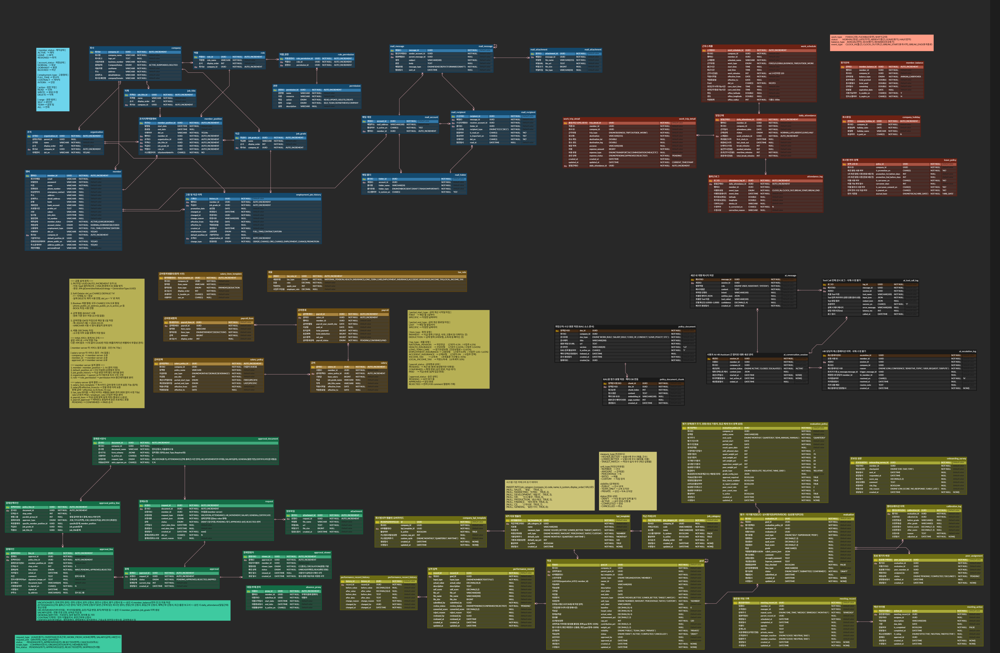

## 목차
- [팀 소개 및 프로젝트 소개](#팀-소개-및-프로젝트-소개)
- [주요 기능](#주요-모듈-기능-요약)
- [기획서](#기획서)
- [기술 스택](#기술-스택)
- [시스템 아키텍처](#시스템-아키텍처)
- [요구사항 명세서](#요구사항-명세서)
- [WBS](#wbs)
- [ERD](#erd)
- [화면설계서](#화면설계서)
- [프로그램 사양서 및 단위테스트결과서](#프로그램-사양서-및-단위테스트결과서)
- [단위 테스트](#단위-테스트)
- [UI / UX 테스트](#ui--ux-단위-테스트)
- [CI / CD 계획서](#ci--cd-계획서)
- [프로젝트 회고](#프로젝트-회고)

---

## 팀 소개 및 프로젝트 소개

|  |  |  |  |
|----------------|-----------------|-----------------|-----------------|
| [김정훈](github1) | [박세민](github1) | [이다은](github1) | [이지연](github1) |

"기록하는 HR → 예측하는 HR" 비전의 **데이터 기반 All-in-One 스마트 HRMS**입니다. 중소기업 HR 담당자의 **'Second Brain'** 역할을 수행하며, 인사 데이터를 중앙화하고 AI로 선제적 인사이트를 제공합니다.

 

  <a href="#목차">🔝 맨 위로</a>

## 주요 모듈 기능 요약

 

  <a href="#목차">🔝 맨 위로</a>

## 기획서

- [Figma 기획서 보기](https://www.figma.com/proto/6suak3PIQpHGzS3UBatOF1/%ED%95%9C%ED%99%94-BEYOND-SW-CAMP-23%EA%B8%B0?node-id=618-102&viewport=696%2C533%2C0.2&t=o5woH0kckAYE5DgS-1&scaling=min-zoom&content-scaling=fixed&starting-point-node-id=618%3A102&page-id=612%3A67)
- [기획서 PDF 다운로드](docs/WORKFORCE_프로젝트_기획서.pdf)

 

  <a href="#목차">🔝 맨 위로</a>

## 기술 스택
### Backend - Spring

### Backend - Python

### Frontend

### Database

### Cloud / Infrastructure

### CI / CD

### Tools

 

  <a href="#목차">🔝 맨 위로</a>

## 요구사항 명세서
- [요구사항 명세서 보기](https://docs.google.com/spreadsheets/d/107CuIWefCSjBbwO0mnKdQJzK5WCFDKYtw5Rs18liJw8/edit?gid=63147339#gid=63147339)

 

  <a href="#목차">🔝 맨 위로</a>

## WBS
- [WBS 보기](https://docs.google.com/spreadsheets/d/107CuIWefCSjBbwO0mnKdQJzK5WCFDKYtw5Rs18liJw8/edit?gid=395838842#gid=395838842)

 

  <a href="#목차">🔝 맨 위로</a>

## ERD

- [ERD 전체 보기](https://www.erdcloud.com/d/Er4amBY2KpweBcKTk)

 

  <a href="#목차">🔝 맨 위로</a>

## 화면설계서

- [Figma 전체 보기](https://www.figma.com/design/FftNc7FU8cuQZS2VnKm3NR/be23-fin-team4-workforce?node-id=0-1&t=AZ9PaJjekutgn9fR-1)

 

  <a href="#목차">🔝 맨 위로</a>

## 프로그램 사양서 및 단위테스트결과서

- 🔗 [프로그램 사양서 및 단위테스트결과서](https://documenter.getpostman.com/view/51059789/2sBXqDrNZT)

 

  <a href="#목차">🔝 맨 위로</a>

