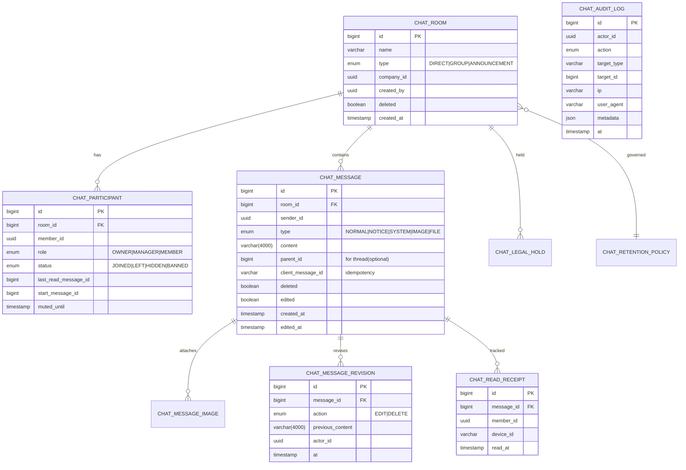

# member-chat (Human Chat) 설계서

> HR 엔터프라이즈 채팅 서비스 — chat-ref 기반 재설계 / Production-grade 고도화
> 대상: `workforce-be` (Spring Cloud MSA)
> 작성일: 2026-04-15

---

## 0. 전제 / 합리적 가정

기존 코드베이스를 분석한 결과 다음을 전제로 한다. 모호한 항목은 명시적으로 가정했다.

| # | 항목 | 가정 |
|---|---|---|
| A1 | 식별자 | 기존 서비스들은 `UUID` 기반(`X-User-UUID`, `X-User-CompanyId`, `X-User-MemberPositionId` 헤더). 신규 채팅 엔티티 PK는 `Long(BIGINT)` 성능 우선, 외부 참조(memberId, companyId)는 `UUID` 사용 |
| A2 | 인증 | Gateway(`JwtAuthFilter`)가 JWT 검증 후 하위 서비스에 `X-User-*` 헤더를 주입. REST는 헤더 신뢰, **WebSocket 은 gateway를 통과하지 않으므로 서비스가 직접 JWT 재검증 필요** |
| A3 | 권한 | 공통 `@CheckPermission(action, resource)` 기반 권한 체계 존재. `Resource.CHAT` 추가(`RE012`) |
| A4 | 조직 모델 | chat-ref 의 `Crew / CrewMember / CrewRole` → HR 도메인의 `Company / Member / MemberPosition / Role` 로 대체. 권한 레벨은 `EMPLOYEE, MANAGER, HR_ADMIN, AUDITOR` 신규 정의 |
| A5 | 모듈 분리 | 본 설계는 `member-service` 내 **별도 패키지 `memberchat`** 으로 분리(동일 JVM). 규모 성장 시 `member-chat-service` 독립 모듈로 승격 가능하도록 경계 설계 |
| A6 | 기존 챗봇 비침해 | `chat/**` 패키지는 유지. 신규는 `memberchat/**` 로 완전 분리. 엔드포인트 prefix `/member-chat/**`, STOMP prefix `/mc/**`, Redis 채널 `member-chat:*`, 설정 키 `member-chat.*` |
| A7 | 파일 저장 | 기존 S3 `bucket3` 재사용하지 않고 신규 버킷 `member-chat-files` 전제(격리/수명 주기 별도) |
| A8 | 메시지 DB | 초기 RDB(MySQL) + 성장 시 파티셔닝/Archive DB. 본 설계는 RDB 단일 테이블 + createdAt 파티셔닝 전제 |
| A9 | Redis | 기존 Redis 인프라 재사용, Pub/Sub 채널 prefix 분리 |
| A10| 법적 요건 | 한국 개인정보보호법 + 회사 내부 감사 요구. 기본 보존기간 3년, legal hold 시 무기한 |

---

## A. 아키텍처 제안

### A.1 현재(chat-ref) 구조

```
[Client] ──SockJS/STOMP──▶ [member-service]
                              ├─ StompHandler   : CONNECT/SUBSCRIBE 시 JWT 파싱(로그만)
                              ├─ StompController: /publish/{roomId} → save
                              ├─ ChatMessageService: JPA 저장 + Redis "chat" publish
                              └─ RedisPubSubService
[Redis Pub/Sub "chat"] ──▶ 구독자 인스턴스 → simpMessageSendingOperations.convertAndSend("/topic/{roomId}", dto)

문제점:
 - CONNECT에서 토큰만 파싱하고 Principal 미설정 → SEND 시 sender를 payload에서 읽는 구조(스푸핑 위험)
 - SUBSCRIBE 시 destination "/topic/{roomId}" 문자열 split → 검증 취약
 - payload.senderEmail 신뢰 → 대표적 STOMP 취약
 - Redis 단일 채널("chat") 모든 방 fan-out → 비효율
 - 읽음 처리 SUBSCRIBE 타이밍 사이드이펙트
 - 감사/보존/rate limit/idempotency 전무
 - 메시지 수정/삭제 이력 없음 (soft delete만)
 - 모놀리틱 챗봇과 혼재 (패키지 충돌 이미 존재)
```

### A.2 목표 아키텍처

```
                     ┌────────── 외부 ──────────┐
                     │ Web / Mobile (STOMP+JWT) │
                     └──────────┬───────────────┘
                                │ wss + Bearer JWT
                                ▼
           ┌────────────── Gateway ───────────────┐
           │ JwtAuthFilter(HTTP)                  │
           │ WebSocket Upgrade passthrough        │
           └─────────────┬────────────────────────┘
                         │
                         ▼
   ┌───────────────── member-service : memberchat ─────────────────┐
   │                                                                │
   │  WebSocket Layer                                               │
   │   ├─ StompChatConfig     (endpoint /mc/connect, broker /mc/topic)│
   │   ├─ ChatStompHandler    (JWT재검증, Principal 주입, 권한캐시)   │
   │   ├─ StompChannelInterceptor (SEND rate-limit, idempotency)     │
   │   └─ StompSessionRegistry (userId→sessionId 멀티디바이스)        │
   │                                                                │
   │  Application Layer                                             │
   │   ├─ ChatRoomService, ChatMessageService(+Notice, Edit/Delete) │
   │   ├─ ReadReceiptService (멀티디바이스 일관성)                    │
   │   ├─ SyncService (lastSeenMessageId 기반 누락 재전송)            │
   │   ├─ AuditLogService (별도 tx, 비동기 kafka 토픽)                │
   │   ├─ RetentionService (스케줄러 + legal hold)                    │
   │   ├─ FileService (presigned URL, MIME/확장자/용량, AV 훅)       │
   │   └─ RateLimiter (Redis 토큰버킷)                                │
   │                                                                │
   │  Domain (JPA)                                                  │
   │   ChatRoom / ChatParticipant / ChatMessage / ChatMessageRevision│
   │   ChatReadReceipt / ChatAuditLog / ChatRetentionPolicy          │
   │                                                                │
   │  Infra                                                         │
   │   ├─ Redis Pub/Sub  channel: member-chat:room:{roomId}         │
   │   ├─ Redis Cache    key: mc:perm:{userId}:{roomId}             │
   │   └─ Kafka          topic: member-chat.audit / .retention.dlq  │
   └────────────────────────────────────────────────────────────────┘
                         │
                         ▼
          ┌──────────────────────────┐
          │  S3: member-chat-files    │  (presigned, versioning on)
          │  + Object Lock(컴플라이언스)│
          └──────────────────────────┘

개선 포인트 (vs 현재):
 1) CONNECT에서 Principal 고정 → SEND/SUBSCRIBE는 Principal만 사용 (payload sender 무시)
 2) Redis 채널을 room 단위로 분리(샤딩) → fan-out 효율
 3) 권한 캐시(TTL 60s) + 방 퇴장/삭제 시 evict
 4) 수정/삭제 이력 별도 테이블 → 감사 추적
 5) 읽음 영수증(ReadReceipt) 이벤트 기반 → 멀티디바이스 일관
 6) 재연결 동기화: GET /member-chat/sync?roomId&lastSeenMessageId
 7) 공지 메시지: MANAGER/HR_ADMIN만, 별도 감사 이벤트
 8) 파일 업로드: presigned + 서버측 MIME sniff + AV 훅(Spring Event)
 9) Retention + Legal Hold: 스케줄러가 delete 대신 archive-then-purge
10) 관측성: MDC(traceId, userId, roomId), Micrometer, OpenTelemetry STOMP span
```

---

## B. 갭 분석표 (현재 vs 목표)

| 영역 | chat-ref 현재 | 목표(member-chat) | 갭 심각도 | 액션 |
|---|---|---|---|---|
| WS 인증 | CONNECT에서 토큰 파싱만, Principal 미설정 | CONNECT에서 `Authentication` 주입, SEND/SUBSCRIBE는 Principal 사용 | 🔴 Critical | StompHandler 전면 재작성 |
| 발신자 신뢰 | payload `senderEmail` 신뢰 | Principal에서 userId 추출, payload sender 필드 제거/검증 | 🔴 | DTO 변경 |
| 인가 | 방 참여자 여부만 | Role(EMPLOYEE/MANAGER/HR_ADMIN/AUDITOR) + 방 타입별 정책 | 🟠 | PolicyService 신설 |
| Destination 파싱 | `split("/")[2]` | AntPathMatcher + `@DestinationVariable` | 🟠 | 재작성 |
| Redis 채널 | 단일 `chat` | `member-chat:room:{id}` | 🟠 | PubSub 리팩터 |
| 메시지 길이 | `length=500` | 4000 + 검증 DTO | 🟡 | 컬럼 변경 |
| 수정/삭제 이력 | soft flag만 | `ChatMessageRevision` 테이블 | 🔴 | 신규 도메인 |
| 감사로그 | 없음 | `ChatAuditLog` + Kafka stream | 🔴 | 신규 |
| 보존/Legal Hold | 없음 | Retention 스케줄러 + hold flag | 🔴 | 신규 |
| 읽음 처리 | SUBSCRIBE 부작용으로 처리 | 명시적 READ_ACK + 멀티디바이스 merge | 🟠 | 리팩터 |
| 재연결 동기화 | 없음 | lastSeenMessageId sync API | 🟠 | 신규 |
| 커서 페이징 | 전체 조회 | before/after cursor + size | 🟠 | Repo 변경 |
| 파일 | presigned 후 검증 없음 | MIME sniff, 확장자 whitelist, 크기제한, AV 훅, 프록시 다운로드 | 🔴 | 신규 |
| Rate limit | 없음 | Redis 토큰버킷 per user+room | 🟠 | 신규 |
| Idempotency | 없음 | `clientMessageId` unique index | 🟡 | 컬럼/인덱스 추가 |
| 에러 코드 | 문자열 예외 | `ChatErrorCode` enum + 표준 응답 | 🟡 | 표준화 |
| 테스트 | 거의 없음 | 단위/통합/부하/보안 | 🟠 | 테스트 스위트 |
| 네이밍 충돌 | `chat` 패키지 공유 | `memberchat` 패키지/`/member-chat/**`/`mc.*` 설정 분리 | 🔴 | 강제 분리 |

---

## C. 도메인 / ERD 변경안

### C.1 테이블 요약

```
chat_room                  -- 방 (GROUP / DIRECT / ANNOUNCEMENT)
chat_participant           -- 참여자 (status, lastReadMessageId, mutedUntil, role)
chat_message               -- 메시지 (content, type, clientMessageId, parentId, replyToId)
chat_message_image         -- 메시지 첨부(Element collection 대체 테이블)
chat_message_revision      -- 수정/삭제 이력 (append-only)
chat_read_receipt           -- 읽음 영수증 (messageId, userId, readAt, deviceId)
chat_audit_log             -- 감사 로그 (actor, action, targetType, targetId, ip, ua, at)
chat_retention_policy      -- 회사/방별 보존정책 (days, legalHold)
chat_legal_hold            -- 개별 방/사용자에 걸린 hold (startAt, endAt, reason, caseId)
```

### C.2 Mermaid ERD



### C.3 주요 인덱스

```
chat_message   (room_id, id DESC)                 -- 히스토리 페이징
chat_message   UNIQUE(client_message_id)          -- idempotency
chat_message   (room_id, created_at)              -- retention 스캔
chat_read_receipt UNIQUE(message_id, member_id)   -- 중복 방지
chat_participant UNIQUE(room_id, member_id)
chat_audit_log (actor_id, at), (target_id, at)
```

### C.4 마이그레이션 전략

- Flyway V1__member_chat_init.sql 로 신규 테이블만 추가 (기존 `chat_*` 테이블 건드리지 않음)
- chat-ref의 레거시 테이블은 **co-exist** → 컷오버 후 아카이빙
- 테이블명 prefix `mc_` 로 최종 격리 권장: `mc_chat_room`, `mc_chat_message`…

---

## D. API 명세

### D.1 REST

Base: `/member-chat`  (Gateway에서 JWT 검증 후 `X-User-UUID`, `X-User-CompanyId` 헤더 주입)

| Method | Path | 설명 | 권한 |
|---|---|---|---|
| POST | `/rooms/direct` | 1:1 방 조회/생성 | EMPLOYEE+ |
| POST | `/rooms/group` | 그룹방 생성 | MANAGER+ |
| GET  | `/rooms` | 내 방 목록(cursor) | EMPLOYEE+ |
| GET  | `/rooms/{roomId}` | 방 상세 | 참여자 |
| PATCH| `/rooms/{roomId}` | 방 설정(이름/이미지/공지) | OWNER/MANAGER |
| DELETE| `/rooms/{roomId}` | 방 soft-delete | OWNER/HR_ADMIN |
| POST | `/rooms/{roomId}/members` | 초대 | OWNER/MANAGER |
| DELETE| `/rooms/{roomId}/members/{memberId}` | 강퇴 | OWNER/MANAGER |
| POST | `/rooms/{roomId}/leave` | 나가기 | 참여자 |
| GET  | `/rooms/{roomId}/messages?cursor=&size=&direction=BEFORE` | 히스토리 | 참여자 |
| POST | `/rooms/{roomId}/messages` | REST 폴백 전송(STOMP 우선) | 참여자 |
| PATCH| `/messages/{messageId}` | 수정 | 작성자 |
| DELETE| `/messages/{messageId}` | 삭제 | 작성자/OWNER/HR_ADMIN |
| POST | `/rooms/{roomId}/read` | 읽음 영수증 (messageId 까지) | 참여자 |
| GET  | `/sync?roomId=&lastSeenMessageId=` | 재연결 시 누락 메시지 | 참여자 |
| POST | `/files/presigned` | 업로드 URL 발급 | EMPLOYEE+ |
| GET  | `/files/{fileId}` | 프록시 다운로드(권한 검사) | 참여자 |
| **Admin/Audit** | | | |
| GET  | `/admin/search?q=&from=&to=&roomId=&memberId=` | 관리자 검색 | HR_ADMIN / AUDITOR |
| POST | `/admin/export` | CSV/JSON 내보내기 | HR_ADMIN (승인 2-step) |
| POST | `/admin/legal-hold` | Legal hold 등록 | HR_ADMIN |
| GET  | `/admin/audit-logs` | 감사 로그 조회 | AUDITOR |

#### 표준 응답 & 에러 포맷

```json
{
  "success": false,
  "code": "CHAT_4031",
  "message": "방에 대한 접근 권한이 없습니다.",
  "data": null,
  "traceId": "e0f1..."
}
```

에러 코드 표준 (예시):

| Code | HTTP | Meaning |
|---|---|---|
| CHAT_4001 | 400 | Validation |
| CHAT_4011 | 401 | Invalid JWT |
| CHAT_4031 | 403 | Not a participant |
| CHAT_4032 | 403 | Not authorized (role) |
| CHAT_4033 | 403 | Room is deleted / user inactive |
| CHAT_4041 | 404 | Room/Message not found |
| CHAT_4091 | 409 | Duplicate clientMessageId (idempotent replay) |
| CHAT_4291 | 429 | Rate limit exceeded |
| CHAT_5001 | 500 | Unexpected |

### D.2 STOMP

| 구분 | Destination | Payload | 발행자 |
|---|---|---|---|
| Connect endpoint | `/mc/connect` (SockJS) | Header `Authorization: Bearer <jwt>` | Client |
| Subscribe | `/mc/topic/room/{roomId}` | - | Client |
| Subscribe(presence) | `/mc/topic/presence/{roomId}` | - | Client |
| Subscribe(read) | `/mc/topic/read/{roomId}` | - | Client |
| Subscribe(user-queue) | `/user/queue/errors` | - | Client |
| Send message | `/mc/app/room/{roomId}/send` | `{clientMessageId, type, content, replyToId?}` | Client |
| Edit message | `/mc/app/message/{messageId}/edit` | `{content}` | Client |
| Delete message | `/mc/app/message/{messageId}/delete` | `{}` | Client |
| Read ack | `/mc/app/room/{roomId}/read` | `{lastMessageId}` | Client |
| Typing | `/mc/app/room/{roomId}/typing` | `{typing:true}` | Client |
| Broadcast(message) | `/mc/topic/room/{roomId}` | `ChatMessageEvent` | Server |
| Broadcast(edit/delete) | `/mc/topic/room/{roomId}` | `ChatMessageEvent(type=EDIT/DELETE)` | Server |
| Broadcast(read) | `/mc/topic/read/{roomId}` | `{messageId, memberId, readAt}` | Server |

#### 서버 → 클라이언트 이벤트 포맷

```json
// ChatMessageEvent
{
  "eventType": "MESSAGE_CREATED|MESSAGE_EDITED|MESSAGE_DELETED",
  "roomId": 123,
  "message": {
    "id": 456,
    "clientMessageId": "cli-uuid",
    "type": "NORMAL",
    "content": "hi",
    "senderId": "uuid",
    "senderName": "세민",
    "createdAt": "2026-04-15T09:00:00Z",
    "editedAt": null,
    "deleted": false,
    "attachments": [{"fileId":"uuid","url":"...","mime":"image/png"}],
    "replyToId": null
  },
  "traceId": "e0f1..."
}
```

#### STOMP 에러 전달

모든 에러는 `/user/queue/errors` 로 표준 포맷 전달:

```json
{ "code":"CHAT_4032", "message":"공지 권한 없음", "correlationId":"cli-uuid" }
```

### D.3 요청 검증 규칙

- `content` 1..4000자, HTML 제거(OWASP java-html-sanitizer)
- `clientMessageId` UUID v4, 최근 24h 내 유니크 (Redis set TTL)
- `type` whitelist: NORMAL, NOTICE, IMAGE, FILE, REPLY
- NOTICE: 송신자 role ∈ {OWNER, MANAGER, HR_ADMIN}
- 파일: image/{png,jpeg,gif,webp} / application/pdf, ≤ 20MB, 개수 ≤ 10

---

## E. 보안 / 권한 정책 표

### E.1 역할 정의 (Room-level / System-level)

| Role | Scope | 권한 |
|---|---|---|
| EMPLOYEE | System | 본인 참여방 조회/전송/수정/삭제(본인 메시지) |
| MANAGER | System | + 그룹방 생성/공지, 팀방 모더레이션 |
| HR_ADMIN | System | + 모든 방 읽기(감사 목적), 강제 삭제, legal hold 설정, export |
| AUDITOR | System | 읽기 전용(모든 방/감사로그), export(서명 필요) |
| OWNER | Room | 방 설정, 멤버 관리, 방 삭제 |
| MODERATOR | Room | 멤버 kick, 메시지 삭제(다른 유저) |
| MEMBER | Room | 기본 송수신 |

### E.2 기능별 인가 매트릭스

| 기능 | EMPLOYEE | MANAGER | HR_ADMIN | AUDITOR |
|---|:-:|:-:|:-:|:-:|
| 방 목록/본인 방 조회 | ✅ | ✅ | ✅ | ✅(전체) |
| 1:1 방 생성 | ✅ | ✅ | ✅ | ❌ |
| 그룹 방 생성 | ❌ | ✅ | ✅ | ❌ |
| 공지 전송 | ❌(방 OWNER만) | ✅(본인 방) | ✅ | ❌ |
| 메시지 전송 | ✅(참여방) | ✅ | ✅ | ❌ |
| 본인 메시지 수정/삭제 | ✅(24h내) | ✅ | ✅ | ❌ |
| 타인 메시지 삭제 | ❌ | 방 MODERATOR면 ✅ | ✅ | ❌ |
| 전체 검색/열람 | ❌ | ❌ | ✅ | ✅ |
| Export | ❌ | ❌ | ✅(2-step) | ✅(서명) |
| Legal Hold | ❌ | ❌ | ✅ | ❌ |
| 감사 로그 열람 | ❌ | ❌ | ✅ | ✅ |

### E.3 WebSocket 보안 절차

1. CONNECT: `Authorization: Bearer` 필수 → `Jwts.parserBuilder().setSigningKey(key)` 검증 → `Authentication` 생성(`SecurityContextHolder`) → `SimpMessageHeaderAccessor.setUser(principal)`
2. SUBSCRIBE: destination 검증(AntPathMatcher `/mc/topic/room/{roomId}`) → `Policy.canSubscribe(user, roomId)` 확인(참여자 + active) → 실패시 `AccessDeniedException`
3. SEND: `principal.userId` 로만 sender 결정 → payload 의 sender 필드 무시 → rate limit → idempotency check → save → redis publish
4. DISCONNECT: SessionRegistry 정리, 마지막 lastReadMessageId flush
5. 비활성 사용자(퇴사/잠금): `MemberStatusService.isActive(userId)` 캐시 60s, 비활성 시 즉시 강제 종료(`SimpUserRegistry` 순회 `disconnect`)

### E.4 파일 보안

- 업로드: presigned PUT, 서버가 `Content-Type`, `Content-Length` 정책 서명
- 업로드 완료 후 `POST /files/confirm` 호출 시 서버가 S3 HEAD로 실제 크기/ETag 확인 → 추가 바이트 선두 MIME sniff(magic number) 검증 → metadata `malware_scan: pending`
- 비동기 AV 훅: `FileUploadedEvent` → ClamAV/S3 Malware Protection 호출 → 결과 저장. `CLEAN` 이전에는 프록시 다운로드 거부
- 다운로드: **프록시 전략** `GET /files/{id}` → 권한검사 → 1시간 presigned GET URL 302 리다이렉트(URL에 개인정보 無)
- S3: bucket versioning, object lock(Legal hold 시), SSE-KMS

---

## F. 단계별 구현 계획 (마이그레이션 포함)

| Phase | 기간 | 목표 | 산출물 | 롤백 |
|---|---|---|---|---|
| P0 | 0.5w | 설계 확정 / 스파이크 | 본 문서, 스키마 DDL | - |
| P1 | 1w | 모듈 스캐폴드, 패키지 격리, 설정 키 분리 | `memberchat` 패키지, Flyway `V1__mc_init.sql` | DDL drop 스크립트 |
| P2 | 1.5w | REST+도메인: 방/메시지 CRUD, 히스토리 cursor, 권한 | 단위/통합 테스트 | 기능 flag `mc.enabled=false` |
| P3 | 1w | STOMP: CONNECT/SUBSCRIBE JWT, 전송, Redis channel 분리 | e2e 테스트 | 레거시 chat-ref 병행 유지 |
| P4 | 1w | 읽음 영수증 + 재연결 sync + 멀티디바이스 | 부하 테스트 | P3 상태로 롤백 가능 |
| P5 | 1w | 파일 업로드/프록시/AV 훅 | 보안 테스트 | 파일 기능 flag off |
| P6 | 1.5w | 감사로그 + 수정/삭제 이력 + retention + legal hold + Admin API | 감사 시나리오 문서 | 기능 flag |
| P7 | 1w | 관측성(Micrometer, OTel), rate-limit, idempotency, 에러 표준화 | 대시보드 | 기본값 off 가능 |
| P8 | 1w | 파일럿 팀 베타, 레거시 chat-ref 데이터 이관 스크립트 | 이관 리포트 | 이관 실패시 원복 |
| P9 | 1w | GA, chat-ref 엔드포인트 deprecate | 릴리즈 노트 | chat-ref 엔드포인트 복구 |

### 기능 플래그 (application.yml)

```yaml
member-chat:
  enabled: true
  websocket:
    allowed-origins: https://app.example.com
  stomp:
    app-prefix: /mc/app
    topic-prefix: /mc/topic
  redis:
    channel-prefix: member-chat:room:
  files:
    bucket: member-chat-files
    max-size-mb: 20
    allowed-mimes: image/png,image/jpeg,image/webp,image/gif,application/pdf
  retention:
    default-days: 1095
    batch-cron: "0 0 3 * * *"
  rate-limit:
    messages-per-minute: 60
    burst: 20
```

---

## G. 테스트 전략

### G.1 단위
- `StompChatHandler` : JWT 파싱/실패/만료/재사용, Principal 주입
- `ChatAuthPolicy` : 참여자/비참여자/비활성/legal-hold
- `ChatMessageService.saveMessage` : idempotency, NOTICE 권한, 길이 validation
- `ReadReceiptService.merge` : 멀티디바이스 단조증가
- `RetentionService.archive` : 법적 hold 있는 방 스킵

### G.2 통합
- Testcontainers(MySQL + Redis)
- `@SpringBootTest(webEnvironment = RANDOM_PORT)` + `WebSocketStompClient`
- 시나리오: CONNECT→SUBSCRIBE→SEND→ECHO, 권한 없는 방 SUBSCRIBE 실패, 재연결 sync
- Flyway 마이그레이션 자동 실행

### G.3 부하
- Gatling/k6: 1만 동시접속, 방당 50명, 초당 1000 msg
- 측정: p95 publish latency, Redis CPU, JVM GC, MySQL QPS
- 목표: send→다른 참가자 수신 p95 < 300ms

### G.4 보안
- OWASP ZAP / Burp : STOMP injection, JWT 위조/만료
- 정적 분석: Snyk, SpotBugs(FindSecurityBugs)
- 악성 파일: EICAR 테스트
- payload에 `senderId` 위조 → 서버가 무시하는지 회귀 테스트(필수 케이스)
- DoS: 1명이 초당 1000건 발송 → rate-limit 발동

### G.5 감사/컴플라이언스
- 메시지 삭제 후 `ChatMessageRevision` 기록 존재 확인
- HR_ADMIN 검색 시 AUDIT 이벤트 생성 확인
- Legal hold 걸린 방은 retention batch가 건드리지 않음

---

## H. 위험 요소 / 롤백 전략

| Risk | 심각도 | 대응 | 롤백 |
|---|---|---|---|
| 기존 챗봇 빌드 충돌 | 🔴 | 패키지/빈 이름/URL/설정 키 완전 분리, `@Configuration` 조건부 | 플래그 off |
| JWT secret 공유로 위조 | 🔴 | CONNECT & SEND 시점 재검증, 만료 짧게, refresh 별도 | secret rotate |
| Redis 채널 폭증 | 🟠 | room 채널 분리, Redis cluster sharding, 백프레셔 | 단일 채널 fallback |
| 메시지 테이블 팽창 | 🟠 | monthly partitioning, Archive DB 이전, S3 cold | Archive 복원 |
| 파일 악성코드 전파 | 🔴 | AV 스캔 완료 전 다운로드 차단, 격리 버킷 | 해당 파일 quarantine |
| Legal hold 위반 삭제 | 🔴 | `RetentionService`에서 `legalHold==true` 필터, 테스트 필수 | 백업으로 복원 |
| payload sender 스푸핑 | 🔴 | Principal 강제, payload sender 필드 제거 | 즉시 핫픽스 |
| 대규모 사내 사용자 경합 | 🟠 | connection rate limit (Nginx), SockJS transport cap | scale-out |
| 레거시 데이터 이관 실패 | 🟠 | dry-run, 이중 write 기간 1주 | 원본 유지 |

---

## I. 소스 구조 (제안)

```
member-service/src/main/java/com/_team/_team/memberchat/
├─ MemberChatProperties.java
├─ config/
│   ├─ StompChatConfig.java
│   ├─ ChatStompHandler.java         (JWT, Principal 주입)
│   ├─ ChatChannelInterceptor.java   (rate-limit, MDC)
│   ├─ StompEventListener.java
│   ├─ ChatSecurityConfig.java       (HTTP /member-chat/** 보안)
│   └─ RedisChatPubSubConfig.java
├─ domain/
│   ├─ ChatRoom.java, ChatRoomType.java
│   ├─ ChatParticipant.java, ChatParticipantStatus.java, ChatRoomRole.java
│   ├─ ChatMessage.java, MessageType.java
│   ├─ ChatMessageImage.java
│   ├─ ChatMessageRevision.java
│   ├─ ChatReadReceipt.java
│   ├─ ChatAuditLog.java, AuditAction.java
│   ├─ ChatRetentionPolicy.java
│   └─ ChatLegalHold.java
├─ repository/ ...
├─ service/
│   ├─ ChatRoomService.java
│   ├─ ChatMessageService.java
│   ├─ ReadReceiptService.java
│   ├─ ChatSyncService.java
│   ├─ ChatAuthPolicy.java           (인가 중앙화)
│   ├─ AuditLogService.java
│   ├─ RetentionService.java
│   ├─ FileService.java
│   ├─ RateLimiter.java
│   └─ RedisChatPubSubService.java
├─ controller/
│   ├─ ChatRoomController.java
│   ├─ ChatMessageController.java
│   ├─ ChatFileController.java
│   ├─ ChatStompController.java
│   └─ admin/ChatAdminController.java
├─ dto/ (req/res)
└─ error/
    ├─ ChatErrorCode.java
    └─ ChatException.java
```

---

## J. 참조 스니펫 (핵심 구현)

> 전체 구현은 phased 로 단계별 커밋. 아래는 보안·인가 중심 핵심 스니펫.

### J.1 ChatStompHandler (CONNECT/SUBSCRIBE/SEND Principal 강제)

```java
@Component
@RequiredArgsConstructor
public class ChatStompHandler implements ChannelInterceptor {
    private final JwtTokenProvider jwt;          // 공통 모듈
    private final ChatAuthPolicy authPolicy;
    private final MemberStatusService memberStatus;

    @Override
    public Message<?> preSend(Message<?> message, MessageChannel channel) {
        StompHeaderAccessor acc = StompHeaderAccessor.wrap(message);
        StompCommand cmd = acc.getCommand();
        if (cmd == null) return message;

        switch (cmd) {
            case CONNECT -> {
                String bearer = acc.getFirstNativeHeader(HttpHeaders.AUTHORIZATION);
                Authentication auth = jwt.authenticate(bearer); // 실패 시 BadCredentialsException
                acc.setUser(auth);
                // 세션에 userId, companyId 저장
                Objects.requireNonNull(acc.getSessionAttributes())
                       .put("principal", auth);
            }
            case SUBSCRIBE -> {
                Authentication auth = (Authentication) Objects
                        .requireNonNull(acc.getSessionAttributes()).get("principal");
                if (auth == null) throw new AccessDeniedException("unauthenticated");
                String dest = Objects.requireNonNull(acc.getDestination());
                RoomTopic topic = RoomTopic.parse(dest);   // AntPathMatcher 기반
                if (!memberStatus.isActive(auth)) throw new AccessDeniedException("inactive user");
                if (topic.needsRoom()) {
                    authPolicy.canSubscribe(auth, topic.roomId());
                }
            }
            case SEND -> {
                Authentication auth = (Authentication) Objects
                        .requireNonNull(acc.getSessionAttributes()).get("principal");
                if (auth == null) throw new AccessDeniedException("unauthenticated");
                // SEND destination 에서 roomId 추출하여 권한/rate limit 체크는
                // ChatChannelInterceptor 에서 별도로 수행
            }
            default -> { /* no-op */ }
        }
        return message;
    }
}
```

### J.2 ChatStompController — sender는 Principal 로만 결정

```java
@Controller
@RequiredArgsConstructor
public class ChatStompController {
    private final ChatMessageService messageService;
    private final ChatAuthPolicy authPolicy;

    @MessageMapping("/room/{roomId}/send")
    public void send(@DestinationVariable Long roomId,
                     @Payload @Valid ChatSendRequest req,
                     Principal principal) {
        UUID senderId = ((AuthPrincipal) principal).userId();   // payload 의 sender 는 무시
        authPolicy.canSendMessage(senderId, roomId, req.type());
        messageService.saveAndPublish(senderId, roomId, req);
    }
}
```

### J.3 ChatAuthPolicy (중앙화된 인가)

```java
@Component
@RequiredArgsConstructor
public class ChatAuthPolicy {
    private final ChatParticipantRepository participantRepo;
    private final ChatRoomRepository roomRepo;
    private final RoleService roleService;

    public void canSubscribe(Authentication auth, long roomId) {
        ChatRoom room = roomRepo.findActive(roomId)
            .orElseThrow(() -> new ChatException(ChatErrorCode.ROOM_NOT_FOUND));
        if (room.isDeleted()) throw new ChatException(ChatErrorCode.ROOM_DELETED);
        UUID uid = AuthUtil.userId(auth);
        if (roleService.isHrAdminOrAuditor(auth)) return; // 전체 열람
        participantRepo.findByRoomIdAndMemberIdAndStatusJoined(roomId, uid)
            .orElseThrow(() -> new ChatException(ChatErrorCode.NOT_PARTICIPANT));
    }

    public void canSendMessage(UUID senderId, long roomId, MessageType type) {
        ChatParticipant p = participantRepo.findActive(roomId, senderId)
            .orElseThrow(() -> new ChatException(ChatErrorCode.NOT_PARTICIPANT));
        if (type == MessageType.NOTICE && !p.canSendNotice())
            throw new ChatException(ChatErrorCode.NOTICE_FORBIDDEN);
    }
}
```

### J.4 Idempotency + Save + Publish

```java
@Transactional
public ChatMessageDto saveAndPublish(UUID senderId, long roomId, ChatSendRequest req) {
    if (req.clientMessageId() != null) {
        messageRepo.findByClientMessageId(req.clientMessageId())
            .ifPresent(existing -> { throw new ChatException(ChatErrorCode.DUPLICATE); });
    }
    rateLimiter.check("mc:rate:" + senderId + ":" + roomId, 60, Duration.ofMinutes(1));

    ChatMessage saved = messageRepo.save(ChatMessage.of(senderId, roomId, req));
    auditLog.record(senderId, AuditAction.MESSAGE_SENT, saved.getId());
    redisPubSub.publish(channel(roomId), ChatMessageEvent.created(saved));
    return ChatMessageDto.from(saved);
}
```

### J.5 수정/삭제 이력 (revision append-only)

```java
@Transactional
public void editMessage(UUID actorId, long messageId, String newContent) {
    ChatMessage msg = messageRepo.findActive(messageId)
        .orElseThrow(() -> new ChatException(ChatErrorCode.MESSAGE_NOT_FOUND));
    if (!msg.getSenderId().equals(actorId))
        throw new ChatException(ChatErrorCode.EDIT_FORBIDDEN);
    if (msg.isOlderThan(Duration.ofHours(24)))
        throw new ChatException(ChatErrorCode.EDIT_WINDOW_EXPIRED);

    revisionRepo.save(ChatMessageRevision.of(msg, RevisionAction.EDIT, actorId));
    msg.updateContent(newContent);
    auditLog.record(actorId, AuditAction.MESSAGE_EDITED, messageId);
    redisPubSub.publish(channel(msg.getRoomId()), ChatMessageEvent.edited(msg));
}
```

### J.6 재연결 동기화

```java
@GetMapping("/sync")
public List<ChatMessageDto> sync(@AuthenticationPrincipal AuthPrincipal p,
                                 @RequestParam long roomId,
                                 @RequestParam(required=false) Long lastSeenMessageId,
                                 @RequestParam(defaultValue="200") int size) {
    authPolicy.canSubscribe(p.auth(), roomId);
    return messageService.fetchAfter(roomId, lastSeenMessageId, Math.min(size, 500));
}
```

---

## K. 결론

- `member-chat` 은 **별도 패키지 `memberchat`** 로 분리되어 기존 `chat` (챗봇) 과 완전히 독립된 URL/STOMP/Redis/설정 네임스페이스를 가진다.
- chat-ref의 장점(실시간, 읽음, 그룹/1:1, Redis fan-out)을 유지하되, **발신자 신뢰 문제·인가 중앙화·수정/삭제 감사·보존/법적 hold·파일 보안·관측성·운영성**을 production-grade로 상향한다.
- Phased rollout + feature flag + 레거시 병행으로 안전한 이행을 보장한다.
