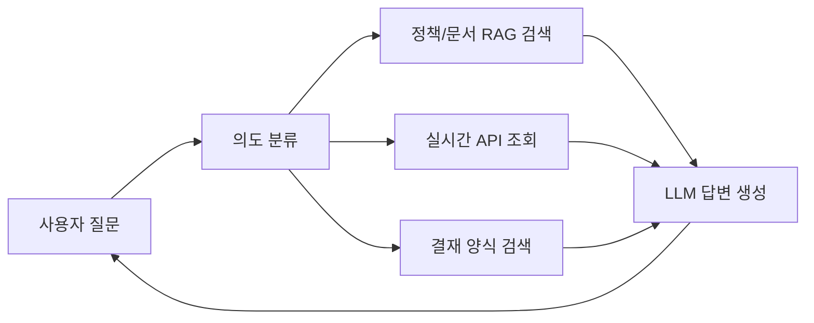
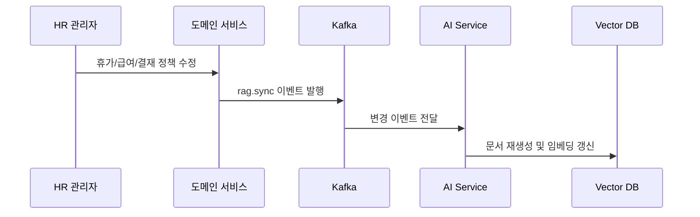

# AI 챗봇 및 RAG 아키텍처

## 목적

WORKFORCE의 AI 챗봇은 신입사원과 일반 사용자가 담당자에게 묻지 않아도 인사 시스템을 사용할 수 있도록 돕는 온보딩 인터페이스입니다.  
핵심은 일반적인 FAQ 챗봇이 아니라, **회사별 정책과 실시간 HR 데이터를 함께 조회하는 맞춤형 AI**입니다.

## 핵심 흐름

## 3-Layer RAG 구조

| Layer | 데이터 | 목적 |
|-------|--------|------|
| Layer 1 Platform | 공통 시스템 사용법, 메뉴 가이드 | 모든 회사가 공유하는 기본 사용 안내 |
| Layer 2 DB Sync | 휴가, 급여, 근태, 결재 정책 | 회사 설정 변경 시 자동 동기화되는 정책 데이터 |
| Layer 3 HR Uploaded | HR 담당자가 업로드한 내부 규정/가이드 | 회사별 별도 문서 기반 답변 |

## 회사별 데이터 격리

- 회사 ID를 기준으로 벡터 저장소 namespace 또는 metadata filter를 적용합니다.
- 회사 A의 휴가 정책이 회사 B의 챗봇 답변에 섞이지 않도록 검색 범위를 제한합니다.
- 시스템 공통 가이드는 공유하되, 정책성 답변은 회사별 데이터를 우선합니다.

## 의도 분류

질문은 다음 카테고리 중 하나로 분류합니다.

| 카테고리 | 예시 질문 | 처리 방식 |
|----------|-----------|-----------|
| 정책 | "우리 회사 연차 기준이 뭐야?" | RAG 검색 |
| 근태 | "이번 달 내 근태 현황 보여줘" | 실시간 API 조회 |
| 급여 | "이번 달 명세서 확인하고 싶어" | 실시간 API 조회 |
| 결재 | "휴가 신청서 어디서 작성해?" | 결재 양식 검색 |
| 목표/평가 | "내 평가 시즌 언제까지야?" | API 조회 또는 정책 검색 |
| ESG | "ESG 포인트는 어떻게 적립돼?" | 정책/기능 가이드 검색 |
| 캘린더 | "내 휴가 일정 보여줘" | API 조회 |
| 사용법 | "연차 신청 메뉴 어디야?" | 플랫폼 가이드 검색 |

## 정책 자동 동기화

정책이 변경되면 각 도메인 서비스가 Kafka 이벤트를 발행하고, AI 서비스가 이를 받아 벡터 DB를 갱신합니다.

## 기술 구성

- FastAPI: AI API 서버
- OpenAI: 임베딩 및 답변 생성
- LangChain: RAG 파이프라인 구성
- Pinecone: 벡터 저장소
- n8n: 의도 분류, 분기, 검색, LLM 호출 워크플로우 오케스트레이션
- Kafka: 정책 변경 이벤트 동기화

## 발표 포인트

- “AI를 붙였다”가 아니라 **회사 정책 변경이 AI 답변까지 자동 반영된다**는 점을 강조합니다.
- 디지털 성숙도가 낮은 조직에서도 메뉴얼 없이 사용할 수 있는 HRMS라는 메시지와 연결합니다.
- 온보딩, 정책 질의, 실시간 조회, 결재 양식 안내를 하나의 대화 흐름으로 설명하면 좋습니다.
