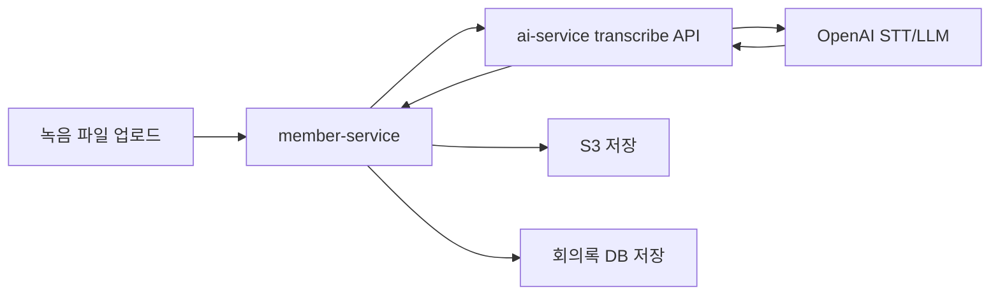

# AI 회의록과 음성 처리

## 개요

AI 회의록은 `member-service`에서 파일과 회의록 메타데이터를 관리하고, 실제 음성 인식과 요약은 `ai-service`의 FastAPI API로 위임합니다.

## 처리 흐름

## member-service 역할

- 업로드 요청 수신
- 사용자/회사 헤더 기반 권한 및 소유자 확인
- ai-service Feign multipart 호출
- 변환 결과 저장
- S3 파일 저장 및 조회/수정/삭제 API 제공

## ai-service 역할

- 오디오 파일 유효성 검증
- OpenAI 기반 STT 처리
- 회의 내용 요약/구조화
- 오류를 FastAPI `HTTPException`으로 반환
