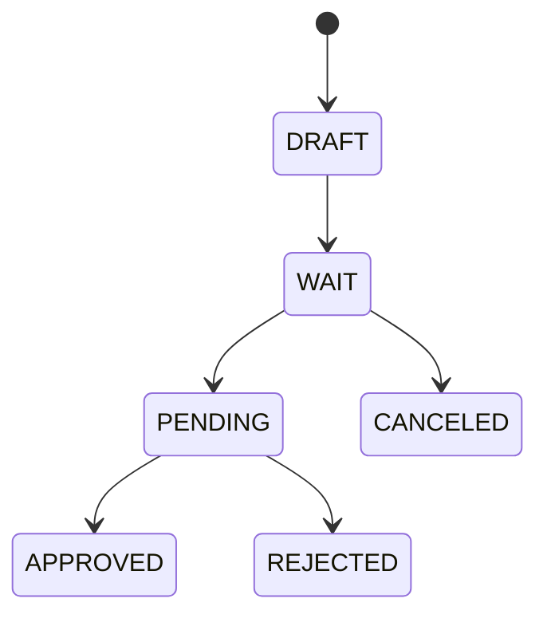

# 전자결재와 전자계약

## 개요

`approval-service`는 전자결재, 동적 결재 양식, 공문, 전자계약을 담당합니다. 결재 승인 이후에는 Kafka 이벤트를 발행해 근태, 캘린더, 인사 발령 등 후속 처리를 연결합니다.

## 전자결재 핵심 모델

| 모델 | 설명 |
|------|------|
| ApprovalDocument | 회사별 결재 양식, JSON formSchema |
| ApprovalRequest | 결재 요청 본문과 상태 |
| ApprovalLine | 단계별 결재자와 처리 상태 |
| Reference/Circulation | 참조/공람 대상 |
| Official Request | 공문 발송/수신 문서 |

## 상태 흐름

## 동적 양식

결재 양식은 JSON formSchema로 저장합니다. 휴가, 근태 정정, 외근, 출장, 인사 발령, 계약 등 요청 유형에 따라 필요한 필드를 회사가 직접 구성할 수 있습니다.

## 후속 처리 이벤트

| 결재 유형 | 후속 처리 |
|-----------|-----------|
| 휴가 | 연차 잔고 차감, 근태 반영, 캘린더 등록 |
| 출퇴근 정정 | 일별 근태 재계산 |
| 외근/출장 | 근태 분류 및 캘린더 반영 |
| 인사 발령 | 조직/직급/직책 변경 및 이력 생성 |
| 사직/퇴직 | 구성원 상태 변경, 퇴직금 정산 연결 |

## 전자계약

- 계약 템플릿을 등록하고 대상자에게 일괄 발송합니다.
- member-service와 salary-service를 호출해 계약서 필드를 자동 채웁니다.
- 법인인감과 직원 서명 이미지를 반영합니다.
- 서명 완료 후 PDF를 생성해 저장합니다.
