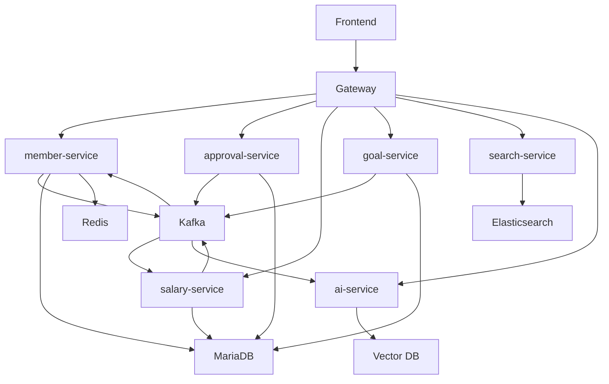

# 시스템 아키텍처

## 서비스 구성

WORKFORCE는 MSA 기반으로 도메인별 서비스를 분리했습니다.

| 서비스 | 역할 |
|--------|------|
| gateway | 인증, 라우팅, 공통 필터 |
| eureka | 서비스 디스커버리 |
| common | 공통 응답, 예외, 이벤트, 인프라 설정 |
| member-service | 회원, 회사, 조직, 권한, 캘린더, 채팅, 알림 |
| approval-service | 전자결재, 동적 양식, 계약 |
| salary-service | 근태, 휴가, 급여, 상여, 퇴직금 |
| goal-service | 목표, 평가, 피드백, 보정 |
| search-service | 통합 검색 |
| ai-service | AI 챗봇, RAG, 회의록 요약 |

## 전체 흐름

## 인프라 구성

| 영역 | 기술 |
|------|------|
| API 서버 | Spring Boot, FastAPI |
| Service Discovery | Eureka |
| Gateway | Spring Cloud Gateway |
| DB | MariaDB, Redis, Elasticsearch, Vector DB |
| Event | Kafka |
| Batch | Quartz, Spring Batch |
| File | AWS S3 |
| Deploy | AWS EKS, ECR, RDS, CloudFront, GitHub Actions |

## 발표 포인트

- 기능별 서비스를 분리한 이유는 HR 업무 도메인이 크고 후속 처리가 많기 때문입니다.
- Kafka는 서비스 간 후속 처리를 연결하고, AI 동기화와 알림에도 사용됩니다.
- 아키텍처 장표는 발표 본문보다 백업 장표로 두고, 질문이 들어오면 상세히 설명하는 구성이 좋습니다.
